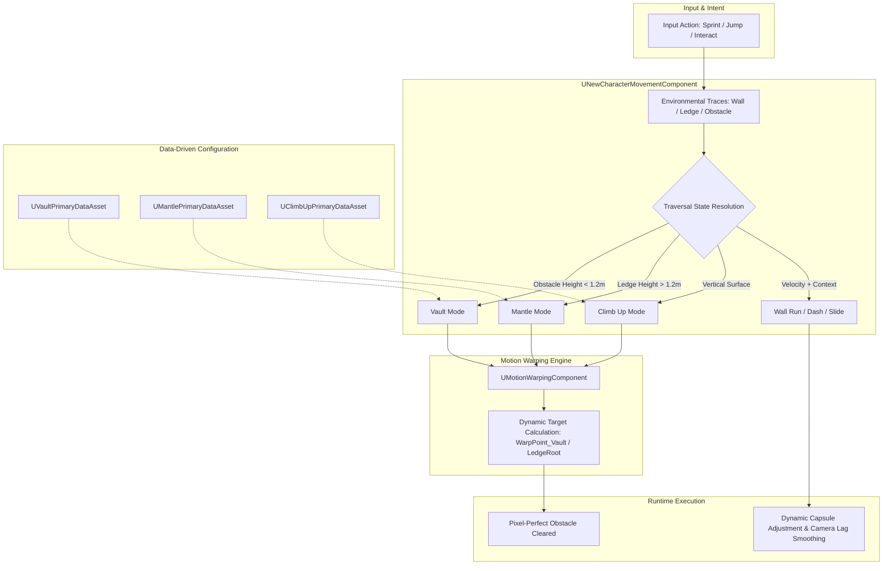

# Character Locomotion System (CLS) for Unreal Engine 5

[](https://www.unrealengine.com/)
[](README.md)
[](LICENSE)
[](https://www.linkedin.com/in/shankharaj-datta-45921a28a/)
[](README.md)

**Character Locomotion System (CLS)** is an enterprise, production-ready C++ movement framework for Unreal Engine 5 (tested and pre-compiled for **UE 5.3, 5.4, and 5.5**). Designed for AAA-grade fidelity and technical flexibility, CLS extends Unreal's native Character Movement Component to deliver fluid parkour, climbing, sliding, and tactical traversal powered by Epic's **Motion Warping** and data-driven `PrimaryDataAsset` architecture.

> [!TIP]
> **Zero Compilation Required for Blueprint Users**: Pre-compiled Win64 editor binaries (`.dll` + `.modules`) are included for Unreal Engine 5.3, 5.4, and 5.5. Simply drop into your project's `Plugins/` folder and hit Play!

---

## 🚀 Key Highlights & Comparison

| Traversal Feature | Standard UE Character Movement | Character Locomotion System (CLS) |
| :--- | :--- | :--- |
| **Parkour (Vault & Mantle)** | ❌ Manual blueprint line traces | ✅ Automated 3-point trace + **Motion Warping** sync |
| **Freeform Climbing** | ❌ None (or basic Flying/Swimming hack) | ✅ Native vertical surface detection & **Climb-Up** transitions |
| **Dynamic Wall Run** | ❌ None | ✅ Surface normal calculation with horizontal & vertical wall traversal |
| **Slide & Prone** | ⚠️ Basic crouch only | ✅ Momentum-conserving sliding with smooth dynamic camera eye-height |
| **Directional Dash** | ❌ Manual AddImpulse scripting | ✅ Direction-aware evasive dashes with root-motion blending |
| **Configuration** | ❌ Hardcoded in character blueprint | ✅ Modular, designer-first **`PrimaryDataAsset`** configs |
| **Network Replication** | ⚠️ Complex custom RPC handling | ✅ Integrated predictive client simulation & server replay |

---

## 🏗️ Architecture & Execution Flow



---

## 🎮 Movement Modes Breakdown

- 🛡️ **Prone & Slide**: Seamless transitions between standing, crouching, and prone states. Dynamic sliding automatically inherits sprinting momentum and smoothly interpolates the character camera eye-height.
- 🧗 **Advanced Climbing**: Comprehensive vertical navigation system with automatic ledge recognition and specialized **Climb Up** logic.
- 🏃 **Wall Run**: Real-time normal surface calculation supporting fluid horizontal and vertical wall transitions.
- ⚡ **Directional Dash**: High-speed, directionally-aware bursts engineered for responsive combat maneuvers.
- 🤸 **Parkour (Vault & Mantle)**: Context-aware obstacle clearing that dynamically reads obstacle depth and height, aligning root motion animations with precision.

---

## 📋 Installation & Quickstart

### 1. Adding to Your Project
1. Choose the folder corresponding to your Unreal Engine version (`5.3`, `5.4`, or `5.5`).
2. Copy the inner `CharacterLocomotionSystem` folder into your project's `Plugins/` directory:
   ```text
   YourProject/
   └── Plugins/
       └── CharacterLocomotionSystem/
           ├── CharacterLocomotionSystem.uplugin
           ├── Binaries/
           ├── Content/
           └── Source/
   ```
3. Open your project in Unreal Editor. Enable the plugin under **Edit > Plugins > Gameplay > CharacterLocomotionSystem**.
4. Ensure Epic's **Motion Warping** plugin is enabled (**Edit > Plugins > Motion Warping**).

### 2. Character Setup (2 Integration Options)

- **Option A — Child Class**: Right-click in the Content Browser > **Blueprint Class** > Search for `NewCharacter` and create a child.
- **Option B — Reparent Existing Character**: Open your existing Character Blueprint > Go to **Class Settings** in the toolbar > Set **Parent Class** to `NewCharacter`.

| Class Settings Setup | Reparenting Existing BP |
| :---: | :---: |
|  |  |

### 3. Interactive Overview & Showcase Blueprint
A dedicated reference blueprint is included inside the plugin content directory showcasing all available movement hooks and functions:
`All > Plugins > CharacterLocomotionSystem Content > Overview > Blueprint > BP_NC_Overview`

<p align="center">
  
</p>

---

## 🛠️ Data-Driven Configuration

CLS uses `PrimaryDataAsset` configurations for fine-grained tuning of traversal states (`Vault`, `Mantle`, `Climb Up`, etc.) without touching C++:

| Configuration Property | Technical Purpose |
| :--- | :--- |
| **Warp Target Offsets** | Precisely adjust landing, hand-placement, and transition points relative to the character root. |
| **Warp Target Names** | Identifier strings (`WarpPoint_Vault`, `LedgePoint`) synced with Animation Montage notify tracks. |
| **Movement Montage** | The root-motion animation sequence applied during traversal. |
| **Timing Controls** | Granular parameters for **Start Duration**, **Play Rate**, and **Blend Out Time**. |

| Data Asset Inspection | Montage Timing Parameters |
| :---: | :---: |
|  |  |

---

## 🔍 In-Viewport Debugging Utilities

Accelerate level design and obstacle placement with built-in visual debuggers:
- **Real-Time State Monitoring**: Toggle trace spheres, ledge hit points, and capsule clearance bounds live in-game.
- **Level Design Validation**: Instantly confirm whether ledges, walls, and obstacles satisfy vault/climb clearance criteria.

<p align="center">
  
</p>

---

## 📥 Sample Project Showcase

A complete, fully configured Unreal Engine sample project demonstrating vaulting courses, climbing walls, sliding ramps, and multiplayer movement replication is available for download:

👉 **[Download Sample Project Showcase (Google Drive)](https://drive.google.com/drive/folders/1DdGjiWPIfIX7JbedweNz_dY-VXvpT5hz?usp=sharing)**

---

## 📄 License & Attribution

Distributed under the **MIT License**. See [LICENSE](LICENSE) for full details.

Created by **[Shankharaj Datta](https://www.linkedin.com/in/shankharaj-datta-45921a28a/)** — feel free to connect for questions, feedback, or custom Unreal Engine gameplay systems development.
